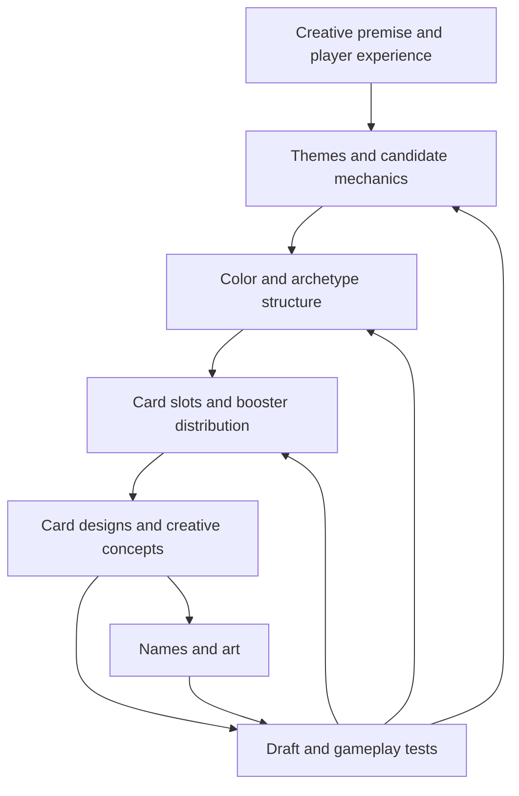

# 01 — Process and validation

[Research index](README.md) · Next: [Colors and archetypes](02-colors-and-archetypes.md)

## Limited is an environment-design problem

Booster Draft gives players three successive packs, alternating passing direction, followed by deck construction with basic lands. The minimum deck size is 40. Players choose from the cards circulating at their table, so a card's usefulness depends on the other available cards and other players' choices. See Wizards' [format overview](https://magic.wizards.com/en/formats/booster-draft).

Rosewater describes Limited as a way to experience a set together, make a large portion of its cards relevant, and test its identity in isolation from older cards. This makes it an early structural concern. Wizards also designs for Constructed and other audiences; Limited is a major constraint, not the sole purpose of every card. [Limited mechanics](https://magic.wizards.com/en/news/making-magic/nuts-bolts-12-part-1-limited-mechanics-2020-03-09).

**Synthesis:** the object being designed is a chain: available cards → pick decisions → plausible decks → interactive games → a recognizable experience. A problem at an earlier link cannot reliably be repaired with more spectacular rare cards.

## Responsibilities across the process

Wizards' 2017 explanation introduced the separation of Vision Design, Set Design, and Play Design. Vision establishes direction and a playable demonstration; Set Design develops the actual set and can revise that direction; Play Design contributes balance work. This replaced an older design/development division. The article's durations and release assumptions are historical. [Process transition](https://magic.wizards.com/en/news/making-magic/vision-design-set-design-and-play-design-2017-10-23).

The August 2026 account describes four stages and their testing priorities:

| Stage | Main question | Testing emphasis |
|---|---|---|
| Exploratory design | Which ideas deserve further investment? | Small constructed test decks isolate mechanics. |
| Vision design | What should this set feel and play like? | Assigned-color sampling, then Sealed, then Draft as the file settles. |
| Set design | Does the complete environment support that vision? | Repeated drafts and increasingly specific card/environment feedback. |
| Play design | Is the experience balanced across relevant formats? | Competitive and casual testing, with continuing adjustments. |

Early sampling assigns colors so every color receives attention. Early vision files can use a relatively even power level so weak placeholders do not go unplayed. Later outside participants supply first impressions the team has lost. These are deliberate experimental choices, not claims that released sets should have identical power levels. [Playtesting](https://magic.wizards.com/en/news/making-magic/playtesting).

Creative work interacts with this process. In the Ikoria account, the creative lead coordinated gameplay, worldbuilding, concept art, card names, illustration, story, and product presentation. It was not a final decorative pass after all mechanical decisions. [Worldbuilding Ikoria](https://magic.wizards.com/en/news/feature/worldbuilding-ikoria-2020-04-07).

## A useful model of the dependencies

The diagram is a synthesis, not Wizards' official organization chart. Arrows show information flow and revision.

A handoff is therefore an argument about the environment: what matters, why its parts belong together, what has worked, and what remains uncertain. Bloomburrow's published handoff contains a central mechanic that did not survive to print. Treating that document as a description of the released cards would reverse its evidentiary meaning. See [case studies](06-case-studies.md).

## What validation should establish

Rosewater's iteration article describes repeated playtest–feedback–revision cycles. Playing repeatedly without using the results is insufficient; the changes are what make it an iterative process. [Iteration](https://magic.wizards.com/en/news/making-magic/nuts-bolts-iteration-2014-03-03).

**Proposed research rubric for our own sets:**

| Layer | Evidence to collect | Failure this can reveal |
|---|---|---|
| Comprehension | A new player explains a card and its mechanic without coaching. | Ambiguous rules or misleading flavor. |
| Availability | Inspect generated packs and complete drafted pools. | An advertised strategy never gets enough support. |
| Draft choices | Record plausible alternatives and changes of direction. | Picking becomes automatic after choosing a label. |
| Deck construction | Build several credible versions of each intended deck. | One exact rare or combination is mandatory. |
| Gameplay | Record stalls, runaway starts, resource bottlenecks, and answers. | A deck exists on paper but cannot execute. |
| Identity | Ask players what the deck and world felt like. | Different names conceal the same experience. |

These tests answer different questions. A preconstructed deck can demonstrate that a mechanic is fun when supplied; it cannot prove that players can draft it. A distribution simulation can show that support exists; it cannot establish enjoyable games. An LLM review can identify inconsistencies; it cannot replace observed play.

## Intent, results, and uncertainty

Wizards' New Capenna retrospective acknowledges that overly strong monocolor commons pushed aggression and two-color decks in a set intended to showcase three-color factions. It also reports color-balance problems, swingy rares, and insufficient draft variety. [State of Design 2022](https://magic.wizards.com/en/news/making-magic/state-of-design-2022).

**Synthesis:** assess whether the strongest practical incentives deliver the promised experience. Neither a faction chart nor a perfectly symmetrical slot count establishes that. For DraftGPT, this calls for feedback across many newly generated sets, since each individual world is meant to be temporary.
