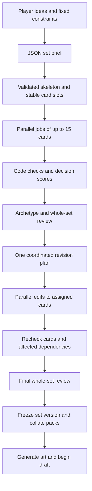

# Model costs and a workflow for generating complete sets

Research date: 2026-10-14. Status: proposal for the card-creation rebuild; no application implementation or paid model experiment.

Designing a shared inventory before collating packs is affordable at current API prices. A modeled workflow using GPT-6 Luna to generate cards and Claude Sonnet 5.5 to plan, review, and revise costs about **$1.68 for 135 unique cards or $2.39 for 270**, including a separate decision-model allowance. Painting every design adds approximately **$0.70 or $1.40**, extrapolated from this repository's image benchmark. The most valuable change is making archetype support, color identity, card availability, and revision properties of the entire environment.

Start with a 135-card pilot and compare the hybrid workflow with Luna throughout. Model quality for invented Magic-style Limited environments needs direct evaluation; vendor classification and coding benchmarks do not establish it.

## Scope and current baseline

“Half set” means **135 unique playable designs** and “full set” means **270** in these estimates. Those are convenient experimental sizes divisible by 15, not a claim about a mandatory Wizards set size. Basic lands, token definitions, alternate art, and card copies are separate. A half set still covers all five colors; it needs fewer mechanics and more shared support rather than half of an ordinary skeleton removed at random.

The current [generation adapter](../../../convex/draft/openai.ts) uses `gpt-4o`. The [pack prompt](../../../convex/draft/prompts/pack.ts) asks for 12 new cards, and [passing constants](../../../convex/draft/passing.ts) specify three rounds of 15-card packs. [Round opening](../../../convex/draft/rounds.ts) fills shortages from the accumulated pool. Assuming every request returns all 12 designs:

| Players | Current new designs | Card copies opened |
|---|---:|---:|
| 2 | 72 | 90 |
| 4 | 144 | 180 |
| 8 | 288 | 360 |

A 270-card inventory is already close to the current eight-player design volume. It is substantially more upfront work for two players, and many designs may never appear. A 135-card inventory can support 360 opened cards by repeating designs according to collation rules. Its suitability depends on variety and support density, not whether the unique count exceeds the physical card count.

Moving to a new model and moving to a shared set are separate changes. Modern models could also reduce the price of the current pack approach. No current pack token-usage benchmark establishes an exact dollar saving from the architecture change alone.

## Verified model prices

USD per million tokens, standard direct API pricing, checked 2026-10-14:

| Service | Input | Output | Role to evaluate |
|---|---:|---:|---|
| GPT-6 Luna, `gpt-6-luna` | $0.10 | $0.50 | Structured card generation; inexpensive alternative for every stage |
| Claude Sonnet 5.5, `claude-sonnet-5-5` | $2.00 | $10.00 | Set planning, diagnosis, contextual review, revision |
| OpenAI Decisions with GPT-6 Luna | $0.10 | No output charge | Typed judgments against defined criteria |
| TypeSafe Jev | $0.042 | No output charge | Alternative typed evaluator |
| Cloudflare Clef | $0.240 | No output charge | Alternative typed evaluator |
| Cloudflare Clef-flash | $0.038 | No output charge | Cheap evaluator for smaller inputs |

Sources: [Luna model card](https://developers.openai.com/api/docs/models/gpt-6-luna), [Anthropic pricing](https://platform.claude.com/docs/en/about-claude/pricing), [OpenAI Decisions](https://developers.openai.com/api/docs/guides/decisions), [TypeSafe's Jev announcement](https://typesafe.ai/blog/introducing-system-one-models-and-jev), and [Cloudflare's October 9 pricing update](https://developers.cloudflare.com/changelog/post/2026-10-09-clef-omni-workers-ai/). Jev's figure is the vendor's published announcement rate. Clef-flash's older $0.090 rate is superseded; its hosted context is now 24K tokens, while Clef retains 64K.

“GPT Decisions” is an API for typed judgments, currently using Luna, rather than a separate card-writing model. These decision services return probabilities, categories, or scores; they do not produce the explanatory review or edited rules text needed for revisions. [TypeSafe's introduction](https://docs.typesafe.ai/introduction) describes this division clearly.

Both Luna and Sonnet 5.5 support structured JSON output. A schema can constrain the form of an answer, but cross-field totals, valid references, and design quality still require checks. See [Luna capabilities](https://developers.openai.com/api/docs/models/gpt-6-luna) and [Claude structured outputs](https://platform.claude.com/docs/en/build-with-claude/structured-outputs).

## Reproducible cost estimate

These are hypothetical token budgets, not measured generations. Output includes an explicit allowance for reasoning as well as visible JSON. The same token assumptions are applied to both model families for comparison; their tokenizers and actual reasoning usage differ. Costs exclude hosting, storage, taxes, human review, and art retries.

Let `N` be the unique card count, `B = ceil(N / 15)`, `E = ceil(0.25 × N)` edited cards, and `R = ceil(E / 15)` revision jobs.

| Stage | Input token allowance | Billable output token allowance |
|---|---:|---:|
| World and set brief | 12,000 | 8,000 |
| Slot allocation | 12,000 | 100 × N + 2,000 |
| Initial card generation | 8,000 × B | 500 × N + 3,000 × B |
| Global review before and after revision | 2 × (8,000 + 350 × N) | 20,000 |
| Ten archetype reviews | 10 × 12,000 | 10 × 3,000 |
| Revise 25% of designs | 12,000 × R | 500 × E + 3,000 × R |
| Decision checks and rechecks | 500,000 half / 1,000,000 full | No output charge |

The 500 tokens per card cover visible rules, metadata, flavor, and art direction. Generation and revision reserve another 3,000 reasoning tokens per job. Slot allocation reserves 2,000 reasoning tokens beyond 100 tokens per slot; planning and review allowances include both visible output and reasoning. Global review receives compact mechanical records, with relevant full records supplied when needed. The ten focused reviews include shared cards and interaction packages. The post-edit global review revisits affected archetypes; another complete suite of ten reviews would be additional work.

The separate decision allowance covers repeated context, rubrics, question groups, and rechecks across many calls. It is a spending assumption, not a measured conversion from number of questions to billed tokens. Measure each provider's usage, including repeated state when splitting requests.

Generative totals are **362,500 input / 194,000 output** for the half set and **553,000 input / 325,000 output** for the full set. Each individual request is below Luna's 272K-input surcharge threshold. The estimate assumes uncached standard processing, without discounts.

| Workflow | 135 cards, text and decisions | 270 cards, text and decisions |
|---|---:|---:|
| Luna for all generative stages | ~$0.18 | ~$0.32 |
| Sonnet for all generative stages | ~$2.72 | ~$4.46 |
| Luna initial cards; Sonnet all other generative stages | **~$1.68** | **~$2.39** |

All three rows include OpenAI Decisions at $0.05 / $0.10. Initial card generation alone is about $0.054 / $0.109 on Luna and $1.089 / $2.178 on Sonnet; the complete workflow costs more because it performs additional design work.

The [local art benchmark](../../specs/card-art.md) measures approximately $0.0052 per image with the current longer prompt. Using that historical measurement for every unique design:

| Workflow with one image per design | 135 cards | 270 cards |
|---|---:|---:|
| Luna throughout | ~$0.89 | ~$1.72 |
| Sonnet throughout | ~$3.42 | ~$5.86 |
| Hybrid | **~$2.38** | **~$3.79** |

For the hybrid pilot, doubling the text allowance while holding art fixed gives **$4.06 / $6.18**. Reserving roughly **$5 / $7 per set** is a useful initial planning budget, not a hard upper bound. If reasoning, repeated reviews, or invalid-output retries grow beyond the assumptions, cost grows with them. Art can be generated only for unique designs actually selected into packs after text is frozen.

Reproduce and modify the arithmetic with `python3 docs/research/limited-set-design/estimate-costs.py`. The [calculator](estimate-costs.py) performs no API calls.

A 15-card generation job is an application grouping. It does not automatically receive a provider's Batch API discount. OpenAI and Anthropic offer 50% discounts for their asynchronous batch services; OpenAI documents a 24-hour completion window. Use ordinary concurrent calls when friends are waiting in a lobby, and evaluate discounted batch processing for advance preparation. Sources: [OpenAI Batch](https://developers.openai.com/api/docs/guides/batch), [Anthropic batch pricing](https://platform.claude.com/docs/en/about-claude/pricing).

## Generate the design brief as answers to a questionnaire

The research in chapters 1–7 maps naturally to a structured brief. The [machine-readable questionnaire](set-design-questionnaire.json) asks about the world, color structure, archetypes, overlap, mechanics, skeleton, collation, creative identity, and validation. Application-owned constraints such as the number of designs remain fixed.

The model answers those questions into a versioned `SetBlueprint` JSON document. A second planning step turns validated targets into an inventory of card slots. Exact counts should be allocated or reconciled by code. Overlapping tags must not be treated as mutually exclusive categories: one blue common might support both blue-red spells and blue-black graveyard decks.

Illustrative excerpt of one slot in the eventual output, not a complete blueprint or provider request:

```json
{
  "slot_id": "CU-07",
  "colors": ["U"],
  "rarity": "common",
  "mana_value_band": [2, 3],
  "card_type": "creature",
  "primary_role": "card_selection",
  "archetype_ids": ["UR_spells", "UB_graveyard"],
  "mechanic_ids": [],
  "complexity_ceiling": "one_short_trigger",
  "power_reference_ids": ["reference_blue_common_looter"],
  "creative_motif": "memory salvagers",
  "cycle_id": null
}
```

The reference ID must resolve to an actual curated reference record before dispatch. A worker receives the frozen brief, exact mechanic definitions, its assigned slots, relevant reference cards, and the creative guide. It returns those slot IDs with complete card records and dependencies. The application validates every response before storing it.

## Proposed generation and revision flow



**1. Freeze a coherent plan before fan-out.** Lock terminology, color roles, mechanic rules, counts, and key creative decisions. Assign every slot exactly once. Cycles and tightly coupled enabler/payoff packages should share a job when possible. Workers must not independently redefine a mechanic or invent competing factions.

**2. Generate nine or eighteen jobs of up to 15 designs.** Fifteen is a reasonable starting point, not a measured optimum. A job is a useful design package, not necessarily a playable booster. Packs are assembled later. Start with bounded concurrency and adjust using real account limits, latency, and retry rates.

**3. Run code checks and focused model judgments.** Code checks schema, counts, IDs, references, mana-symbol consistency, text length, duplicate names, and required tokens. Decision calls screen semantic concerns against explicit rubrics. Exact mechanical checks should not be delegated to probabilistic scoring.

**4. Review across job boundaries.** Assemble each archetype's full support, including shared monocolor cards. Give a generative reviewer the actual cards, curve and support statistics, references, and counterplay. Run a whole-set review for omissions, repeated effects, dominant colors, insufficient fixing, and mechanic conflicts. A local review of fifteen cards cannot see the entire environment.

**5. Produce one revision plan, then edit in parallel.** The reviewer creates issues containing card IDs, severity, evidence from card text or counts, intended change, and affected dependencies. Resolve conflicting proposals before assigning edits. An editor preserves slot purpose and stable identity. A change to a mechanic definition invalidates every dependent card's review; it cannot be treated as an isolated wording fix.

**6. Recheck and freeze.** Recompute counts and exposures, rerun relevant judgments, and perform the final global review. A bounded revision pass prevents an endless scoring loop. Unresolved serious issues leave the candidate unready for drafting; a retry or fallback policy belongs in the implementation spec. Generate final art after text stabilizes.

Scheduled jobs would need the existing generation key plus a set revision and stable job ID. Stale results must do nothing, retries must not duplicate slots, and identical art must be reused for duplicate copies. These are extensions of the repository's existing scheduling rules, not implemented behavior.

## What decision models can usefully assess

Use narrowly defined questions with the card, its slot contract, relevant rules, and comparison cards as context:

| Dimension | Useful question or rubric |
|---|---|
| Slot fit | Does this card actually perform its assigned early-game or interaction role? |
| Color identity | Is its principal effect within the supplied color policy? |
| Complexity | Does understanding this common require multiple linked or novel rules concepts? |
| Relative power | Compared with these same-role references, is it weak, typical, strong, or an obvious outlier? |
| Archetype contribution | Is it an enabler, payoff, flexible support card, or unrelated to the stated plan? |
| Creative cohesion | Do its name, flavor, and art direction match the supplied world guide? |

Keep power, complexity, and relevance separate. Do not collapse them into one “quality 8/10” that editors can improve by making every card stronger. A format needs ordinary creatures, modest answers, and commons that explain its rules.

Decision output can route a card to a revision category. A generative reviewer then explains the defect and proposes a change. Low confidence or evaluator disagreement should trigger contextual review rather than automatic rejection. A confident classification is not proof of correct Magic rules or balanced gameplay.

Calibrate with human-labeled examples: ordinary commons, intentional bombs, confusing text, missing enablers, and deliberately broken interactions. Include reference cards with changed names to reduce reliance on recognition. Evaluate false negatives on dangerous designs and false positives on unusual but sound designs; reserve held-out examples. Neither evaluator consensus nor the writer scoring itself replaces this exercise.

At the modeled **one million decision input tokens per full set**, the evaluator charge would be $0.038 for Clef-flash, $0.042 for Jev, $0.10 for Decisions, or $0.24 for Clef. This assumes equivalent billed-token volumes, not identical tokenization or quality. Even the largest difference is only about twenty cents. Start with Decisions for the existing OpenAI integration and compare alternatives on the labeled examples before adding a vendor for savings alone.

For smaller-context services, send a card package, archetype slice, or relevant interaction group. Do not silently truncate a whole set to fit. Count question text and repeated shared state in the budget, and split question arrays according to the selected endpoint's limits.

## Benefits and limits of designing an inventory first

**Predictable support.** A skeleton can reserve cheap creatures, removal, fixing, enablers, and payoffs before slots are consumed by exciting rares. Shared support makes neighboring decks compete for picks and allows players to pivot.

**Controlled exposure.** A rarity label affects play only through collation. Code can sample many virtual drafts and measure how often players see a mechanic, how many cheap creatures appear, and how much fixing is opened. For a simple rarity-slot model, expected mechanic appearances per pack are the sum over slots of `P(slot rarity = r) × P(mechanic card | r)`; real duplicate and collation policies should be simulated directly. Availability simulation measures availability, not win rates.

**Coherent rules and aesthetics.** All workers share exact mechanic definitions, naming patterns, materials, and faction motifs. The whole-set editor can remove redundant effects and contradictory world details.

**Review before players commit to picks.** Revision can repair a missing enabler or excessive removal before the first pack. A frozen inventory also supports reproducible drafts, comparisons, and optional future reuse with new collation seeds.

**Different waiting and spending patterns.** Planning and reviews add sequential work before drafting. Parallel card generation reduces that stage's wall time, but the total depends on the slowest jobs, rate limits, retries, and art. There is no measured latency promise for this pipeline. Smaller tables may pay for many unseen designs; advance generation and painting only opened designs can reduce the practical impact.

**Balance remains empirical.** Pairwise comparisons and contextual reviews can find suspicious designs. They cannot establish win rates, uncover every combo, or prove that an archetype is enjoyable. Draft simulations can measure structural properties; human drafts and games remain necessary for format quality. This work does not require adding turn or legality enforcement to DraftGPT's manual play table.

## Pilot recommendation

Use **135 unique designs, all five colors, a deliberately small mechanic vocabulary, and nine generation jobs**. Evaluate whether ten pairs have adequate shared support; reduce theme fragmentation if they do not. Give Sonnet the brief, slot planning, review, and revision, Luna the initial card jobs, and Decisions the focused checks. Run a comparison with Luna throughout using the same brief and rubrics.

Record actual input, output and reasoning tokens; retries; time per stage; schema failure rate; reviewer disagreements; edited-card share; distribution of support across simulated drafts; and human draft/play feedback. Compare both workflows with the current pack approach on cohesion, power outliers, novelty, and player waiting time. Use those results to choose the model allocation, card count, and whether fifteen is the right job size before implementing the production rebuild.
