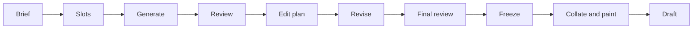

# Set generation and setting design

Status: default for new app drafts. Prompt 13 adds [five-axis whole-set critique and revision](set-review.md), building on [structured lobby creative guidance](lobby-creative-guidance.md) while retaining the selected world policy, Default/Busted selection, executable-rules boundaries and current-text review. `SET_GENERATION_ENABLED=false` selects the legacy path for Default; Busted requires the set pipeline. The October 21 calibration study is complete, but full-set quality acceptance failed; human playtest acceptance remains open. Not deployed to production.
Date: 2026-10-14. Updated 2026-10-21.

The user selected GPT-6 Luna for all generative stages on 2026-10-15. On 2026-10-16 they approved removing required Decisions screening: code validation, contextual reviews, one edit pass and final review now form the normal pipeline. Decisions remains an offline evaluation tool.
On 2026-10-16 the user set the design target to Modern Horizons strength. The [power reference library](../research/limited-set-design/10-modern-horizons-power.md) provides 72 rarity/type/band examples plus 15 role and combo references. Default retains this catalog. Prompt 10 also supports the separate [Busted reference pool](../research/limited-set-design/16-busted-power.md), requested on 2026-10-20. Both modes consume role-ranked references and factual support summaries throughout generation and review. Human calibration and playtest acceptance remain open. See [October 2026 Luna prompting research](../research/limited-set-design/11-luna-prompting.md).

Scope: [refactor step 6](refactor-roadmap.md#step-6-card-creation).

## Outcome

Friends contribute ideas, then receive a coherent, original draft environment designed around those ideas. Before the first pick, DraftGPT creates a setting and archetype plan, assigns a complete inventory of card slots, generates cards in parallel, validates and reviews them, and makes one coordinated editing pass. The three rounds draw from the resulting frozen inventory.

This wave replaces independent pack design and the 2024 setting prompt. It preserves the existing draft, deckbuilding, and manual-table experience. A new draft creates a new setting; this wave does not introduce a reusable set library, collections, automated matches, or game-rule enforcement.

## Decisions and initial defaults

The user selected these model responsibilities:

| Responsibility | Model or API |
|---|---|
| Setting and archetype creation | GPT-6 Luna, `gpt-6-luna` |
| Card generation | GPT-6 Luna, `gpt-6-luna` |
| Contextual review and editing | GPT-6 Luna through Responses |
| Optional offline classification experiments | Decisions using `gpt-6-luna`; absent from normal runs |

The following are implementation defaults proposed by this spec. They are tunable through versioned server configuration and pilot evidence, not additional decisions players must make in the lobby:

- Luna also plans the skeleton and writes contextual reviews and revision instructions. Luna performs targeted card rewrites as part of card generation.
- Start the pilot with 135 unique designs. Support 270 through the same pipeline. Initial rollout uses 135 for two to four participants and 270 for five to eight, subject to the evaluation gate below.
- Support all five colors and all ten two-color pairs. Themes should share resources rather than require ten isolated card packages.
- Generate at most 15 cards per job, with an initial limit of four concurrent card-writing jobs per lobby. Provider-wide limits must also be respected.
- The initial prompt profile requests familiar mechanics only. The contract can represent zero or one new mechanic, but the first real candidate exposed ambiguous invented rules; introducing a new mechanic is deferred until stronger semantic evaluation. A distinctive world need not invent a keyword.
- Perform one coordinated editorial pass after initial review. Transport retries and malformed-response repairs are separate from editorial rounds.
- Keep the current image model and pulp-art traditions. Paint unique designs selected into this draft only after card text is final.

Unique designs exclude basic lands, tokens, and duplicate copies. Tokens and linked dependencies still count toward prompt complexity and validation. The production profile is fixed when the roster is frozen; it does not change if someone disconnects.

## Legacy baseline

The [setting prompt](../../convex/draft/prompts/setting.ts) requests eight archetype names and descriptions, three legendary components, and one mandatory new mechanic. It lacks explicit color-pair coverage, support counts, overlap, curves, fixing, or a concrete visual guide. It asks only one or two archetypes to use the new mechanic without establishing whether enough cards will make that mechanic relevant.

The [pack prompt](../../convex/draft/prompts/pack.ts) requests twelve cards independently. [Round opening](../../convex/draft/rounds.ts) tops packs up to fifteen from accumulated card copies, without a designed rarity distribution. The [parser](../../convex/draft/parsing.ts) accepts a setting with a name and thesis and fills many missing fields with empty values. Cards currently combine a design, its image, and the independently pickable copy in one record.

The existing recovery work remains valuable: saved designs survive art failures, scheduled steps carry generation keys, stale results are ignored, and stalled work can be retried. Extend those guarantees to a complete set rather than replacing them with a long in-memory chain.

## Player experience

1. Players contribute ideas and ready up through the existing lobby flow. The host can choose Default or Busted before starting; a change clears everyone’s readiness. Players can optionally support messages with “Use this idea.” Starting freezes the roster, power level and complete bounded conversation, including support. Existing start authorization remains unchanged.
2. The generating screen shows meaningful stages: **Gathering your ideas** (when chat is nonempty), **Creating the world**, **Designing cards**, **Reviewing the set**, **Refining cards**, and **Preparing packs**. Show completed-card counts only when they represent persisted, validated work. A stage need not expose provider names, prompts, costs, or review scores.
3. Once the setting brief is frozen, players can read its premise, color-pair themes, and exact mechanic reminder text. This introduces the format without exposing card lists, pack contents, or reviewer-identified bombs.
4. The first round opens only after the set passes final validation and all three rounds have saved pack manifests. Art is best effort within a bounded wait; cards remain readable with placeholders.
5. Subsequent rounds open from saved manifests without asking a text model to invent more cards. Existing passing directions, picks, absence handling, and deck transfer continue to work.
6. Refreshing or reconnecting shows persisted progress. A terminal generation failure shows a concise explanation and the existing host recovery control. Recovery resumes a failed stage without discarding successful work. Quality failures requiring a fresh candidate are distinguished from transient retries.

A separate member-only guidance query shows preferences, source quotes and the world’s inclusion/adaptation/omission plan. The public setting response contains only the player-facing guide. Design inventory, reviewer notes, future packs, and internal metrics remain server-side. Outsider queries return `null` or `[]` as appropriate.

## Setting prompt redesign

### Prompt structure

Replace the expertise persona and long catalog of existing planes with a concrete assignment, a compact design questionnaire, bounded examples, and an explicit response schema. The prompt should ask for design decisions and short supporting explanations, not a hidden reasoning transcript.

Use these sections in order:

| Section | Required content |
|---|---|
| Product contract | Original, powerful but interactive Magic-style Limited for friends; supported card representation; five colors; manual tabletop constraints |
| Fixed configuration | Unique-card count, supported color pairs, rarity profile, mechanic limit, complexity limits, prompt/schema versions |
| Player intent | Validated extracted preferences, source references and distinct support signals from the frozen conversation; raw chat goes only to interpretation |
| Design questions | World, color identities, archetypes, overlap, mechanics, creative guide, power and interaction goals |
| Output contract | Required JSON fields, enums, IDs, references, and length limits |
| Self-check | Every pair covered, shared support present, mechanic fully defined, effects within supported representation, world expressed through ordinary cards |

Prompt intent, to be converted into the actual tested prompt:

> Design a setting that can sustain a complete draft environment. Connect the players' ideas through a wondrous physical premise and a conflict between immense supernatural powers or processes. Give the magic observable effects, limits and consequences. If human factions drive the conflict, give them extraordinary capabilities, bargains or resources with powerful defined effects. Give each color a distinct approach to that conflict. For every color pair, explain its early plays, resources, way to win, weaknesses, and shared support with neighboring strategies. Define any new mechanic precisely and provide accessible enablers, payoffs, and counterplay. Favor specific, playable expressions of the world over additional lore or keywords. Return only the requested structured brief.

Preserve the current instruction boundary around player ideas. A suggestion to ignore the schema, change model behavior, or reveal hidden data must not affect the contract. Empty ideas should produce a complete world. Conflicting ideas require explicit, honest adaptation or omission; do not force every noun into a faction or infer agreement. Record every preference’s disposition and expose its explanation to players without a relevance score. See the [lobby guidance contract](lobby-creative-guidance.md).

### Required brief answers

The [research questionnaire](../research/limited-set-design/set-design-questionnaire.json) is source material for the production schema, not an API-ready schema. Split its answers into a creative/mechanical brief and a subsequent slot plan so one response does not have to finish all planning at once.

| Brief object | Required answers |
|---|---|
| `world` | Name, one-sentence premise, concise description, central conflict, emotional tone, player fantasy, recurring people/places/objects |
| `experience` | Intended pace, power references, interaction principles, common-card complexity, excluded play patterns |
| `colors[5]` | Explicit W/U/B/R/G identity, world role, strengths, weaknesses, mechanical resources, visual cues |
| `archetypes[10]` | Stable pair ID, explicit colors, name, early game, resource engine, win condition, vulnerabilities, enabler/payoff roles, signpost role, support targets |
| `overlap` | Shared resources and card roles between named archetypes; contested picks and plausible pivot paths |
| `mechanics` | Stable ID, new/returning classification, exact definition and reminder text, colors/rarities, enablers, payoffs, counterplay, required tokens or markers |
| `creativeGuide` | Materials, silhouettes, locations, motifs, naming conventions, faction variations, exclusions compatible with the existing pulp direction |
| `ideaInfluences` | Input IDs and concise descriptions of how each selected suggestion shaped the setting |

Novelty should come from the relationships between world and play. Remove the requirements that every world invent a mechanic and that only two archetypes may touch it. If a new mechanic is included, require one simple example application and one counterplay example in the internal brief. Those examples are explanatory and do not become inventory cards automatically.

Ten pair IDs are fixed: WU, WB, WR, WG, UB, UR, UG, BR, BG, RG. Pair identity is explicit data, never inferred from a name. Do not hardcode the same ten strategies for every setting. Familiar play patterns may recur, but their resource relationships and expression should follow the world.

Preserve the product's powerful-card intent with explicit role-appropriate reference bands. “Vintage Cube,” “Modern Masters,” and competitive constructed decks should not be interchangeable power instructions. The current implementation defines the Modern Horizons target in `set/references.ts` and retrieves up to 48 role-ranked reference cards from its generated catalog. References retain full-cost and support caveats. `set/support.ts` distinguishes partial samples from complete inventories and reports observed curve, assignments and possible missing mechanics. Human calibration remains a rollout gate. Evaluate curve, interaction, and synergy together. References inform function and power, not copied names, rules text, or creative identity.

### Prompt acceptance

- Empty, coherent, conflicting, humorous, and instruction-like input fixtures all produce structurally valid briefs or bounded, recoverable failures.
- Every valid brief has all five color identities and ten unique pair entries with nonempty play patterns and vulnerabilities.
- Every archetype names shared support with at least two neighboring pairs. Code checks references and coverage; semantic review checks whether the overlap is useful.
- New mechanics have complete definitions and supported tabletop requirements. Unsupported representation fails before card writing.
- The creative guide provides concrete motifs usable in common-card names and art, not only legendary characters and abstract adjectives.
- Human comparison against the old prompt checks specificity, influence of player ideas, coherence, distinctness of archetypes, and practical playability. Schema compliance alone does not pass this gate.

## Blueprint and slot allocation

Version the blueprint, prompt, schema, rubric, and generation profile independently. A run records all of them plus its model configuration and immutable idea snapshot.

Luna proposes role allocations within a fixed integer budget. Pure code validates and reconciles the allocation into exactly one slot per intended design. Invalid plans return structured violations for a bounded planning repair; they never reach card workers. Allow at most two semantic planning repairs after the initial response, then fail with an actionable plan error.

Initial inventory profiles are tuning baselines:

| Unique-card profile | Common | Uncommon | Rare | Mythic | Total |
|---|---:|---:|---:|---:|---:|
| Half | 70 | 40 | 20 | 5 | 135 |
| Full | 140 | 80 | 40 | 10 | 270 |

The planner allocates balanced monocolor coverage, ten uncommon pair signposts, shared support, fixing, creatures across the curve, interaction, and a limited number of narrow payoffs. Record explicit counts and acceptable ranges for each profile before card generation. Exclusive color and rarity buckets must sum to the inventory count; overlapping archetype and role tags must not be summed as exclusive categories.

Each slot includes:

```ts
type CardSlot = {
  slotId: string;
  colors: Color[];
  rarity: Rarity;
  manaValueRange: [number, number];
  cardType: string;
  primaryRole: string;
  archetypeIds: PairId[];
  mechanicIds: string[];
  complexityCeiling: string;
  powerReferenceIds: string[];
  creativeMotif: string;
  cycleId: string | null;
};
```

The type is an illustrative contract; production validators need explicit enums, bounds, and reference checks. Slot IDs survive editing. Paired designs and cycles should share a job where possible. Each slot is assigned to exactly one active writing job.

Start with the card faces the application already renders. Do not permit double-faced cards, unsupported variable power/toughness, new card-frame requirements, or mechanics needing new UI pieces in this wave. Tokens use existing manual token facilities and must have complete definitions. A parser must reject unsupported designs instead of silently converting them into misleading values.

## Card generation and evaluation

Each Luna job receives the frozen brief, exact mechanic definitions, its slots, relevant references, and the shared creative guide. Request structured output with one record per slot, using the Responses API through the provider adapter. Do not blindly carry over the old Chat Completions sampling and forced-tool parameters.

Validate the returned slot ID set, supported card representation, normalized mana notation, colors, rarity, required fields, and dependencies. Empty/missing/wrong-slot output is a repairable failure, not permission to reduce the inventory size. Persist valid slots and request only rejected or missing slots on repair. Allow two semantic response repairs per writing job; transient retry limits remain separate. Never regenerate accepted cards because an image failed.

### Runtime checks and offline experiments

| Layer | Responsibilities | Result |
|---|---|---|
| Pure code | Schema and ID integrity, count/curve/rarity constraints, supported syntax, duplicate names, declared references, token dependencies, collation properties | Exact violations with affected IDs |
| Offline Decisions experiments | Optional slot/mechanic, color, complexity, power-floor, power-ceiling and creative classifications | Experimental labels; not supplied to normal runtime reviews |
| Luna review | Whole-archetype support, cross-batch interactions, redundant effects, power outliers, contradictory mechanics, world cohesion | Evidence-backed issues and a coordinated edit plan |

Prompt v7 uses low reasoning for brief, slots and generation; medium for contextual review, edit planning, revision and final review. Decisions retains a separate offline classification contract; normal generation makes no screening or rescreening calls. These are provisional defaults, not established optima. Inspect requests with `scripts/inspect-set-prompt.ts`; evaluate development regressions with `scripts/evaluate-power.ts` and the 15-card `scripts/evaluate-set-prompts.ts` pilot. That pilot defaults to the current review-only flow; `--with-screening` opts into the older classification experiment. Review/edit-plan/final calls allow 24,000 output tokens, including reasoning; budget reservations include that headroom, rendered prompts and questions.

Keep review dimensions separate. Do not optimize one aggregate quality score or treat high confidence as proof of balance. Use card text, slot purpose, reference cards, and relevant support as input. The writer's self-assigned role tags are claims to verify, not sufficient evidence that the card supports an archetype.

Every card reaches contextual review regardless of any offline classification. Reviewers assess power floor, ceiling, colors, mechanic fit, wording and concrete prose from card text and reference evidence. Retry transport failures within policy; unresolved review failures remain recoverable failures, never approval.

Evaluate review diagnoses and repairs on a versioned human-labeled fixture set, including strong valid commons, bombs, color breaks, confusing wording, missing enablers and broken interactions. Preserve held-out cases. Reintroduce Decisions only if a comparison demonstrates additional correct findings or safely reduces review work.

Luna performs ten archetype reviews plus a global review. Archetype inputs include shared cards, curve/support statistics, interaction and fixing, and the actual text of relevant cards. The global review uses a compact complete inventory and can expand affected groups. A local fifteen-card screen cannot substitute for this stage.

### Coordinated editing

An issue contains `issueId`, `scope`, affected slot IDs, severity (`blocker`, `major`, `minor`), category, concise evidence, requested correction, and dependencies. Unknown card IDs or unsupported requested changes invalidate the review response. Code deduplicates issues; Luna resolves contradictory edits into one plan before dispatch.

Luna rewrites assigned cards while preserving their slot contracts. Changing the frozen world, mechanic rules, or skeleton is outside a local edit. If review shows the blueprint itself is unsound, stop the candidate and offer a full restart with a new generation key; do not quietly mutate every worker's assumptions.

Recheck edited cards, their dependent cards, and all aggregate constraints. Luna then performs a final global review using the initial issues and changes, with affected archetypes expanded. Final review receives the complete current inventory, including unchanged cards and the prior issues. The set becomes ready only when hard checks pass and no blocker or major issue remains. Minor issues are recorded for evaluation and do not force endless edits.

The cost estimate assumes roughly 25% of cards need editing. This is an estimate, not a correctness cap: all required edits in the single planned pass must fit the remaining budget or the run fails explicitly. After that pass, unresolved serious issues require a fresh candidate. Retrying the same quality failure must not loop indefinitely or erase the failure report.

## Pack collation and art

Create all round manifests after the inventory freezes. Use a server-generated saved seed and pure collation functions so retries reproduce the same result. The seed is scoped to this draft and is not a player-facing set-reuse feature.

Initial collation policy:

- Fifteen nonbasic cards per pack: ten commons, four uncommons, and one rare slot that upgrades to mythic with probability 1/8.
- No duplicate design within one pack. Designs may repeat across packs and rounds. For each slot, sample uniformly from its eligible designs, excluding those already in the pack; do not sample already-created copies.
- Each pack includes at least one monocolor common of each color. Draw those five common slots first, then the remaining five from the eligible common pool, and shuffle the final pack. A profile without adequate eligible commons fails skeleton validation. This is a constructive bounded algorithm, not an unbounded rejection loop.
- Basic lands remain available through deckbuilding. Generated nonbasic lands and artifacts occupy ordinary rarity slots.
- Validate support exposure through simulations for the actual roster size. Gold signposts do not replace accessible monocolor support. The pilot may revise the profile, but the frozen run stores the exact policy version it used.

Manifest publication and round opening are idempotent. Each manifest position creates one independently pickable card copy. Duplicate copies share a canonical design and image but have separate `pickedBy` and pack state. Existing draft picks and deck/game snapshots must remain independent.

Generate art once per selected design and reuse it for every copy, including copies in later rounds. Persist the chosen tradition and final art prompt so retries do not change style. Combine the world/faction guide with the current pulp constraints. An art failure does not invalidate approved card text or force a new draft.

The first round waits only for a bounded art-preparation period. Later art can complete in the background; missing images use placeholders. New card copies, deck entries, and game snapshots retain the canonical design reference for resolving presentation through exported draft-domain reads. Their rules and ownership remain snapshots. Late art therefore becomes visible without rewriting game rules or ownership; legacy records use their existing image fields. Avoid copying or deleting shared storage objects as though each card copy owns its image.

## Persistence and scheduling

Keep the implementation in the draft domain. Suggested records are responsibilities rather than a requirement to store an entire set in one document:

| Record | Responsibility |
|---|---|
| Generation run | Lobby, mode/profile, immutable ideas and versions, phase, current key/revision, progress, spend reservation, terminal failure |
| Blueprint | Frozen setting/archetype brief and validated skeleton for a run revision |
| Card design | Stable slot ID, versioned card face, tags, dependencies, review state, canonical art reference |
| Generation job | Stage, slot scope, input versions, key, attempt, scheduler ID, status, usage, reserved spend, result references |
| Review result | Rubric/version, evaluated input hashes, decisions or issue records, resolution state |
| Pack manifest | Run revision, round/seat, saved seed/policy, ordered design IDs and publication state |
| Existing card copy | Pack, picker, canonical design/version reference, compatible card-face data |

Store cards and jobs as bounded records; avoid repeatedly rewriting a giant inventory document. Candidate edits may update working designs, but freeze publishes an immutable version. Picks always reference that frozen version.



Every stage persists its result before scheduling successors. A stage requiring no edits may pass directly through revision/recheck with an explicit completed result. Completion of parallel jobs advances the barrier exactly once in a transaction.

Every scheduled action carries a run key, revision, job ID, and attempt key. Check liveness and current ownership before calling the provider and again before storing or advancing. Retries replace attempt keys; edits invalidate affected review hashes; full restarts replace the run key. A closed lobby or superseded attempt accepts no late text writes. Delete only newly created orphan image objects from rejected uploads, never canonical images shared by valid copies.

Use short actions, bounded concurrency, provider timeouts, existing backoff/retry-after handling, and watchdogs per job. Do not fit the complete pipeline into the current single pack action budget. Watchdogs inspect the matching attempt and reschedule only eligible work. Reconnecting does not schedule duplicate work. Host recovery resumes failed jobs and preserves accepted artifacts; it cannot silently select an older candidate.

Lobby transitions go through exported lobby functions. Parsing, allocation, routing, edit dependency checks, and collation belong in pure core modules. Convex handlers load, call them, and write.

## Provider boundary and compatibility

Extend the OpenAI adapter for Responses and Decisions. All raw replies pass through draft parsers before storage. Normalize timeouts, rate limits, provider failures, refusal, and invalid output into existing error/retry conventions without leaking raw provider payloads to players.

External calls remain confined to `openai.ts` and `images.ts`. `OPENAI_API_KEY` is the only provider credential. The fake OpenAI service implements Responses, Decisions, images, and the legacy Chat Completions path. Test-stack startup explicitly selects the fake endpoint and removes the rollback variable to exercise the default pipeline locally.

Existing settings, packs, cards, decks, and games must remain readable. Store the generation mode on a newly started lobby/run; missing mode means legacy. Enable the new path only for new drafts. Existing in-progress legacy drafts finish through their original generation mode. Rolling back the new-start flag must not break new-mode drafts already in flight.

Additive schemas and a version-aware setting projection allow old and new settings to coexist. Update `settings.forLobby`, `SettingInfo`, and `GeneratingScreen` together. Explicitly audit `pickFace`, `CardFace`, mana parsing, card rendering, art prompts, deck transfer, game snapshots, fake services, and every generation consumer before changing shared output shapes. Do not rewrite historical decks merely to fit the new blueprint.

## Cost and operational limits

The [research estimate](../research/limited-set-design/08-model-costs-and-generation-workflow.md) models Luna throughout at approximately $0.18/$0.32 for text and $0.89/$1.72 including art for 135/270 cards. Actual usage is recorded separately; the retained $5/$7 ceilings provide recovery room, not a forecast.

Start with configurable spend ceilings of $5/$7 for a candidate, including art, and record actual usage. Before dispatch, reserve estimated maximum request cost against the remaining allowance in a transaction; reconcile with reported billable usage afterward. Concurrent jobs must not independently see and spend the same remaining balance. Include reasoning, repeated input, retries, and uncertain timed-out calls in accounting. An application estimate is not a guaranteed provider invoice cap; keep a provider-side budget as an operational backstop.

If required text work cannot fit the allowance, expose a recoverable budget error rather than skipping review. Optional art stops at its allowance and uses placeholders. A host's recovery action retains the run's spent amount; it does not reset the budget counter. A fresh candidate records a new candidate budget and retains prior spend in lobby totals.

Log stage durations, token categories, request IDs, model and prompt versions, parse failures, retries, screened/flagged/edited counts, review resolutions, image counts, and estimated cost. Do not log keys or hidden reasoning. Save the input snapshot and returned artifacts needed for development comparison under existing member access boundaries.

No hard generation-time promise is made before measurement. Record first-pack-ready latency and subsequent-round latency separately. Ordinary concurrent API requests serve live lobbies; discounted asynchronous Batch APIs are outside this wave.

## Work packages and dependencies

Each package is a reviewable implementation change with integration coverage before new backend behavior. Following the Glass Inlet preview, the user approved making this pipeline the app default on 2026-10-16. Deployment still requires separate approval; human power calibration and playtests remain open.

| Package | Work | Completion evidence |
|---|---|---|
| 1. Contracts and provider adapters | Versioned config and parsers, Luna Responses/Decisions support, fake services, usage/error normalization, provider-boundary docs | Fixtures cover supported replies, refusal, bad JSON, timeouts, rate limits; no old sampling parameters accidentally carried over |
| 2. Setting and archetype redesign | New prompt and schema, fixed idea snapshot, five colors/ten pairs, mechanics/creative guide, strict validation and bounded planning repairs | Prompt acceptance cases pass; signed-in participants see the correct setting projection and outsiders see nothing |
| 3. Blueprint and design inventory | Pure allocation, profile counts, slots, canonical design records, run/job state, migration compatibility | Exact inventory and reference checks; old drafts/settings/decks remain readable |
| 4. Parallel card generation | Bounded fan-out, per-slot persistence, partial repairs, keys, barriers, retries, watchdogs, budget reservations | Out-of-order completion and repeated callbacks produce exactly one design per slot; stale work cannot advance a run |
| 5. Review and editorial pass | Versioned rubric, archetype/global review, issue plan, Luna rewrites, dependency invalidation, final gate | Deliberately broken fixtures are routed and repaired or fail explicitly; clean cards survive; no unbounded revision loop |
| 6. Collation and shared art | Pure seeded manifests, independent copies, all-round preparation, deduplicated art, best-effort image fallback | Correct packs/rounds and duplicate behavior; retry never changes manifests; failed art never regenerates text |
| 7. Player flow and rollout | Stage progress, setting guide, recovery states, compatibility projection, full fake-stack/browser acceptance, measured pilot | Complete two- and eight-player drafts; human quality comparison; deployment and production validation recorded separately |

Packages 1–3 establish the contracts needed by 4. Package 5 consumes persisted generation output; 6 requires the freeze gate. Package 7 integrates all of them. Do not enable a partial path that bypasses contextual review or silently falls back to legacy independent packs mid-run.

## Acceptance and validation

### Automated behavior

Drive public functions as signed-in players for lifecycle and access tests. Internal fake job completions are test fixtures after public setup. Add pure tests where allocation, collation, or dependency invalidation could silently break a format.

- Two-player and eight-player runs produce the selected 135/270 inventory, three rounds, fifteen cards per pack, and forty-five picks per player.
- Concurrent start/completion/retry requests do not create duplicate runs, slots, manifests, images, or picks.
- A disconnect, refresh, host recovery, stalled action, provider rate limit, partial response, and out-of-order callback preserve successful work.
- A superseded run/attempt, invalid revision, or closed lobby cannot write cards, attach art, or advance the phase.
- A missing pair, malformed mechanic, invalid dependency, unsupported card shape, or serious unresolved review issue prevents readiness.
- Budget reservations survive concurrency, timeouts, and recovery; exceeding an allowance never bypasses required review.
- Every pack has the intended rarity/color composition and no internal duplicate. Duplicate designs in different packs remain independently pickable.
- Seeded retries reproduce manifests; later rounds do not call a text model. Shared art remains available when individual copies move into decks or games.
- Queries do not reveal inventory or future packs; outsiders receive no private setting or generation details.
- Legacy settings and active drafts remain usable when the feature flag is enabled or rolled back.

Run `bun run test`, `bun run typecheck`, `bun run lint`, and `bun run build` after integration. Browser-visible changes follow [the browser-testing skill](../../.claude/skills/browser-testing/SKILL.md) on the fake-service stack, including two sessions, both themes, reconnects, recovery, readable setting information, card placeholders, and round transitions.

### Model and format quality

Build a fixed evaluation corpus of at least twelve idea bundles spanning empty input, coherent worlds, conflicting suggestions, humor, and instruction-like messages. Compare old/new setting briefs using the same input snapshots. Human review should find a clear improvement in world specificity, player-idea influence, playable archetypes, overlap, and visual direction. Record failures and prompt versions rather than selecting only attractive examples.

Review evaluation must report held-out missed serious defects and unjustified changes to unusual but valid cards. Every curated blocker fixture must either be flagged or caught by contextual review before freeze. Generic model benchmarks and agreement between models do not satisfy this gate.

Generate at least one 135-card and one 270-card candidate with real providers, inspect the complete outputs, and run seeded availability simulations for two, four, and eight players. Review enabler/payoff exposure, curves, removal, fixing, and duplicate frequency. Human draft/play sessions must assess whether players can identify and build the intended strategies, whether games allow counterplay, and whether the world feels coherent. Structural simulations cannot establish win rates.

Record actual cost and first-pack latency against the planning envelope. Tune profiles, prompt lengths, concurrency, or review scope using evidence before enabling new drafts by default. Production deployment still requires the repository's explicit approval, and a real production draft is a separate validation milestone.

## Documentation and completion

During implementation, update architecture, tech stack/environment variables, card art, relevant draft specs, the refactor roadmap, and AGENTS service boundaries in the changes that make them true. Keep this spec's status explicit as packages are implemented. Research remains background evidence; this spec owns the chosen workflow.

Step 6 closes when the model allocation, new setting prompt, inventory generation, review/editing, collation, shared art, recovery, compatibility, and player flow pass the acceptance above, and production status is recorded accurately. Writing the spec or passing local tests alone does not close it.

## Implementation record

The implementation uses `convex/draft/set/` for pure contracts, prompts, slots, collation and validation, with `setRuns`, `setQueue`, `setJobs`, `setAdvance`, `setWorker`, `setPacks`, and `setArt` as persistent orchestration. A shared slot skeleton reserves rarity, type, mana range, and archetype coverage before the model fills roles, mechanics and motifs. Common artifacts are colorless; fixed assignments prevent the model from silently starving a pair.

`bun --env-file=.env.local scripts/preview-set.ts [output-directory]` runs the same model adapters and pure validation stages outside Convex, checkpoints each request, generates a 135-design inventory and exports one collated fifteen-card pack with optional art and an HTML review page. The Convex scheduler is exercised separately through integration/browser tests. Preview artifacts and credentials are ignored by Git. Add `--finish` after the output directory to resume only art/rendering from an existing `set.json`. Preview exports may show a failed candidate for human inspection, clearly marked as not draft-ready; the app still blocks such a candidate.

The October 15 pilot left broader real-provider validation, reviewer calibration, human draft/play evaluation and production deployment open. Required Decisions screening has since been removed; contextual-review fixtures replace that obsolete calibration gate. See the October 20–21 release validation record for current non-playtesting evidence. A single preview cannot establish balanced win rates.

Live pilot (2026-10-15): `.artifacts/pack-preview-v2/` contains a 135-card candidate, 675 initial screening decisions, 22 revised designs and one fifteen-card illustrated pack. Final review retained three issues, so the export is marked for human review and the app readiness gate would block it. Development text usage for this candidate was about $0.2186, including retries; image accounting uses conservative reservations. The pilot exposed reviewer false positives and fixing-cycle gaps. The current skeleton/validator now fixes all ten land pairs explicitly. This is evidence for continued calibration, not format acceptance.

## Prompt and power revision (2026-10-15)

The user rejected the abstract Glasswake premise and weak preview cards. [Concrete prose and card power](../research/limited-set-design/09-concrete-writing-and-power.md) records the reading, examples, failure analysis and limits of the evidence.

The October 15 revision introduced prompt 4, rubric 2 and profile 2; prompt 8/rubric 4 now supersede its prompts and screening while retaining profile 2. `set/creative.ts` requires physical geography and actions, concrete-to-concrete comparisons when useful, subtext through selected detail, and observable magic. It applies to setting prose, names, flavor, motifs and art directions; technical gameplay language remains literal. The initial preview used a dispute over salvage, grain and a bridge. Prompt 8 replaces that mundane emphasis with observable supernatural conflict (see below).

That revision targeted a strong interactive custom cube; the current target is explicitly Modern Horizons strength. Commons must earn deck slots; rarity is not a tax on efficiency. Writers, Decisions and editors now assess the cost of setup, sacrificed cards, activation/equip mana and missed board development. Underpowered cards are explicit review defects. Nerfs require evidence of a concrete affordable sequence and inadequate counterplay. One-shot enters effects are not automatically repeatable-removal problems.

`set/curve.ts` replaces the type-independent mana cycle with role-specific bands. The 135-card profile has forty common creature slots, including five per color capped at three mana, ten common instant slots, and affordable artifacts/enchantments. Five- and six-mana creatures explicitly demand impactful effects. Rarity totals, ten gold signposts, fixing coverage and pack collation remain fixed. Existing frozen sets are not rewritten.

`bun --env-file=.env.local scripts/evaluate-set-prompts.ts [prior-set.json] [output-directory]` runs a text-only development probe with a $0.50 cap, eleven known weak designs and four controls. It preserves the original mana/type contracts to isolate prompt behavior from the new curve. Its artifacts contain the source cards, new brief, generated replacements, reviews and reported usage (plus screens only with `--with-screening`). This probe does not replace a held-out corpus, a new complete set or playtesting.

## Luna prompting and reference tools (2026-10-16)

Current versions are pipeline 3, prompt 11, rubric 5, references 4 and profile 3. The [Luna prompting research](../research/limited-set-design/11-luna-prompting.md) owns the official-source analysis, request/tool design, evaluation commands and measured limitations. Deterministic role retrieval supplies the same full-cost reference policy to writers and reviewers; factual support reports prevent partial samples from being mistaken for complete sets. The power-floor and ceiling criteria remain in contextual review. Normal runs skip both Decisions stages and do not send classification labels to editors. Required mechanic omissions are major review defects. Repair feedback identifies the slot and exact violated world, rarity or type constraint.

The final development pilot produced 15 new cards and revised nine. Final review retained a major token-definition inconsistency, so this is an unapproved sample. Medium review performed better than low on the small development suite; a medium-writing replay accepted only 13 of 15 slots and did not justify changing the low-writing default. These results leave the existing human/held-out/playtest gates open.

## Review-only generation (2026-10-16)

New runs follow brief → slots → generate → review → edit plan → revise → final → art. Code validation remains at each provider boundary. The pipeline retains legacy `screen`/`rescreen` stage handling for already queued jobs and offline adapter tests, but creates no new screening jobs. Saved legacy tasks remain readable. The preview CLI follows the same review-only sequence and paints the 15 selected designs with at most four concurrent art requests under its $5 budget.

The removal addresses redundant work: the old screening result did not control which cards were reviewed. It does not establish that Luna's reviews or repairs are correct. Quality failures still block automatic app publication; development HTML exports display unresolved issues for human inspection.

The first complete review-only run, Glass Inlet, generated 135 designs and revised 63 before exporting a seeded 15-card illustrated pack at `.artifacts/pack-preview-v7-review-only/index.html`. Final review retained one major issue and two minor issue groups, so the candidate remains unapproved. Recorded text estimates total $0.17588, plus $0.60 in conservative art reservations; canceled in-flight requests are not reconciled with billing. No Decisions calls occurred. The run also exposed name-repair feedback and checkpoint replay defects, now corrected. See the [completed run record](../plans/completed/review-only-pack.md) for validation and remaining quality limitations.

After user review of that pack, new app drafts now select this pipeline without opt-in configuration. Explicit `SET_GENERATION_ENABLED=false` remains a rollback for new starts only; existing set and legacy drafts continue their saved path regardless of later configuration changes. App jobs and the preview use `set/repair.ts` to preserve accepted cards, reserve their names, narrow remaining design context, and enforce fixed constraints during bounded repairs. The app retains its final-review publication gate: approval of a preview does not automatically approve every generated candidate. This source change is not a production deployment.

## Generation batch-size evaluation (2026-10-19)

The [batch-size study](../research/limited-set-design/12-generation-batch-sizes.md) compares 5, 15, 30 and 45 cards per request over two complete 135-card inventories per size. Generation plus structural repair averages 76.8s, 65.9s, 63.0s and 62.9s respectively. All slots are filled; one five-card response needs a token-definition repair. Forty-five reduces estimated writing cost and duplicate-name counts, but all candidates still need set-level repairs. These measurements exclude planning, gameplay review/editing and art, and do not establish end-to-end startup time.

`scripts/evaluate-batch-sizes.ts` saves measured calls, bounded repairs and repeated blinded global reviews under a $3 text-only cap. Its explicit executor options expand the response schema and output allowance for larger experimental requests. Normal app and preview generation remain at 15 with the existing 14,000-token allowance. Quality findings and limitations belong to the study; no batch-size default has changed.

## Creative seeding evaluation (2026-10-20)

`scripts/evaluate-creativity.ts` compares concrete world seeds, professional perspectives and broader slot jobs in all eight combinations with two fifteen-card samples each. The optional executor instruction suffix is recorded in request context and budget estimation; normal application calls do not supply it. The runner keeps generation, structural repair and sample review separate, without art or gameplay editing. Its [protocol and results](../research/limited-set-design/13-creative-seeding-eval.md) own the measurements and limitations. `scripts/creativity-eval/render.py` produces the offline HTML comparison. This historical study used prompt 7. After human review, the user selected the combined approach; prompt 8 applies the revised policy below. The protocol-1 runner refuses fresh generation under other prompt versions because the broad-job factor is now part of the baseline. Saved reports remain renderable.


## Historical prompt-8 fantasy and combined-creativity policy (2026-10-20)

Superseded by prompt 9 below after the user rejected repeated worlds and preferred the baseline’s handling of abstract metaphor. This section records the previous implementation, not the current default.

The user preferred all three interventions together but rejected the worlds' mundane economic/faction conflicts. This is a human preference decision, not a statistically demonstrated winner. Prompt 8 adopts randomized creative ingredients, a discovery perspective and broad slot jobs in normal set generation.

`set/creativeSeed.ts` samples an extraordinary terrain, an immense power, a magical catalyst and a perspective from versioned pools. It derives a separate random stream from the saved run seed, without consuming the collation stream. The expanded ingredients and perspective are saved in the initial brief job; retries reuse that exact task. The pools are starting material that the writer may transform to accommodate player ideas, not whole worlds or mandatory lore. Finite pools and stochastic generation do not guarantee uniqueness. This is prompt diversification, not an API sampling seed; temperature/top_p and model settings are unchanged.

The brief must center observable supernatural conflict: vast beings, magical transformations, planar intrusions or other forces with specified capabilities, constraints and consequences. Human factions are optional; if central, their leaders, bargains, relics or resources must grant consequential supernatural power. Ordinary work, trade and politics can show consequences but cannot substitute for the fantasy premise. Color identities need not be factions, and ten color pairs do not mean ten guilds. Common cards must also express the world's magic.

Concrete description still means literal, imaginable subjects and precise concrete-to-concrete comparisons. It does not prohibit sentient weapons, living landscapes, resurrection or time magic when their actual behavior is defined. Writers and reviewers preserve the frozen world's magic and distinguish observable supernatural behavior from empty abstract atmosphere. The art prompt preserves supernatural scale while retaining one readable subject and the economical pulp style.

Slot planning now states contribution, useful floor and connection to an archetype's resource plan, leaving exact effects and numbers to the writer. Only indispensable mechanic IDs are assigned; assigned mechanics still bind the card writer. Fixed slots, Modern Horizons references, structural repair, contextual review and final publication gates remain in force.

The preview CLI uses the same seed helper and saves the expanded selection in `creative-seed.json` under its output directory (default `.artifacts/pack-preview-v8`). Its example ideas concern a bound sea creature and guardians that turn to glass. Resumed briefs retain their existing frozen world. The fake service uses the same fantastic premise as a UI fixture, not as evidence of model quality.

Validation: integration coverage verifies saved creative inputs survive a malformed-brief repair and disappear from downstream task payloads, while players receive the frozen setting and a fifteen-card pack. All 122 tests, typechecking and lint pass. A two-player browser smoke test with fake services showed the revised serpent/guardian setting to both players and dealt fifteen cards to each, with no browser errors. The inspected screenshot is `.artifacts/fantasy-prompt-v8/setting.png`; the local test stack was stopped afterward. A subsequent [five-world-per-mode real-provider comparison](../research/limited-set-design/14-fantasy-comparison.md) produced 150 cards for human review; model/playtest acceptance remains open. Historical prompt-7 outputs are preserved; this revision does not regenerate them or deploy production.


## Five-world fantasy comparison (2026-10-20)

`scripts/evaluate-fantasy.ts` runs protocol 2: five current-fantasy baselines versus five all-three worlds, one fifteen-card preview per world and an independent sample review, without art or gameplay editing. The baseline omits creative inputs and uses the earlier specific-job slot instruction; all-three uses the current application policy unchanged. The eval-only stage-instruction override is included in execution, request auditing and reservation estimates. [Protocol and results](../research/limited-set-design/14-fantasy-comparison.md) describe the controls and limitations. `scripts/fantasy-eval/render.py` creates an offline world/card comparison with notes. Normal generation does not supply an override.


## Current world diversity and literal prose policy (prompt 9)

The user rejected both prompt-8 modes as too similar and preferred the baseline's handling of abstract metaphor. Prompt 9 removes the story examples, persona instruction and mandatory extraordinary-terrain opening. It keeps the high-fantasy target, but magic can center on beings, practices, civilizations, artifacts or conflicts as well as geography. World premise/description/conflict must be literal; emotional subtext comes from observable detail, not abstract substances or personification. Premises should be short complete sentences. Cards retain sparing concrete-to-concrete comparison in flavor, and literal art directions.

`set/worldDirection.ts` supplies four broad design questions: setting focus, conflict structure, access to magic and visual emphasis. Each has eight general categories, with no supplied names, characters or completed plots. New runs read at most twelve recent `setRuns` and prefer the least-used category in each dimension, with deterministic seeded tie breaking. The run saves `worldDirection` as JSON, and the initial brief task stores the same expanded direction. Repairs and resumes reuse that task; a new candidate gets a new allocation. The allocator uses only system-owned category labels, never another lobby's ideas, names, world descriptions or cards. Queries do not expose allocation history. This is bounded category rotation, not semantic duplicate detection or a uniqueness guarantee.

Writers and reviewers ask for distinct subject families, magical actions and name stems within a world; pair plans need distinct resource loops while sharing useful support. Broad slot jobs remain, because the world/prose comparison does not isolate their effect. Fixed contracts, Modern Horizons power references and review gates are unchanged.

Preview defaults to empty player input and `.artifacts/pack-preview-v10-default`, using the same allocator and saving `world-direction.json`; a standalone preview has no cross-run history unless provided by its caller. Existing world briefs and historical eval artifacts are preserved. The old seed helper remains for historical protocols; normal app and preview runs no longer use it.

The user selected this policy for default world and card creation on 2026-10-20. World creation receives the allocated direction; slot planning, card writing, contextual review, edit planning, revision and final review all receive the shared card creative policy and frozen blueprint. Normal runs use Luna throughout and retain fifteen-card writing batches and the Modern Horizons power target.

The [five-world probe](../research/limited-set-design/15-world-directions.md) records real-provider results, including remaining repetition and ambiguous wording. Selecting the policy does not establish semantic uniqueness or balanced card power; broader calibration and playtesting remain open. No card/art generation or production deployment is claimed by that probe.


## Selectable power level (prompt 10)

The lobby host chooses **Default** or **Busted** before starting. Default is the current Modern Horizons target. Busted targets powered Vintage Cube strength, with fast mana, free interaction and explosive supported combos. Everyone sees the choice; changing it clears all ready flags, while selecting the same value does nothing. Only an authenticated host in an open lobby can change it. The chosen label remains visible during generation and drafting.

`lobbies.powerLevel` and `setRuns.powerLevel` are optional enum fields for backward compatibility. Missing values mean Default. Starting freezes the choice on the run; enqueueing stamps every task with that value and a stable reference seed. Repairs/resumes reuse it, and a fresh candidate inherits the locked lobby choice. World planning, slot planning, writing, contextual review, edit planning, revision, final review and optional offline screening all use the selected policy. Player ideas cannot override it. Existing Default runs and the legacy path remain supported; choosing Busted always uses the set pipeline even when the legacy rollback flag is set.

Default keeps the existing references and curve. Busted uses a separately sourced pool of exactly 1,000 distinct cards, with 916 eligible for direct slot comparisons; retrieval is capped at 48 references. It has cheaper artifact/interaction slots and premium engine opportunities, while retaining colors, pairs, pack composition and fifteen-card batches. Real-world rarity is comparison metadata. Default's too-strong labels are never applied to Busted. The [Busted research record](../research/limited-set-design/16-busted-power.md) owns source methodology, pool limitations and reproduction commands.

The preview supports `--power-level=default|busted`, freezes the choice and versions in `preview-config.json`, stamps it on every task and labels the report. It rejects incompatible resumed briefs or saved sets. Neither fake-service verification nor reference coverage establishes the quality of real generated cards; paid generation and playtesting remain separate validation.

### Executable rules and current-text review (prompt 11)

The October 20 release evaluations exposed two separate failures: invented game procedures copied from world fiction (such as moving an undefined physical heart), and final reviews repeating a defect already repaired in the current text. Some critics also tried to replace game timing with fictional sunrise timing, treated an instant as necessarily cast before blockers, or called optional targeting of opposing creatures a rules error.

Prompt 11 makes the world/game boundary explicit for all stages. Names, flavor and art describe physical events; rules and archetype engines express them through defined game actions, objects, counters, costs and timing. A turn is not necessarily a fictional day. Review must inspect the current full costs and actual legal timing. An undeclared procedure invented by a card writer is a card-level repair, not automatically a broken frozen world.

The final provider payload retains the prior issue IDs, severities, slots and requested corrections, but replaces stale defect evidence with a historical-check label. Stored review records retain the original evidence for audit. Current designs remain the source of truth; the final publication gate still blocks major/blocker issues. This reduces anchoring without disabling independent review or silently approving failures.

Busted reference retrieval reserves room for Mana Crypt, Sol Ring, Black Lotus and Mox Diamond when zero-cost artifact slots are present, within the same 48-reference cap. This supplies actual repeatable and one-shot acceleration comparisons rather than treating all free mana as a defect. Prompt/rubric/reference versions are 11/5/4. Real-provider follow-up results are recorded separately from the original prompt-10 candidates.


### Release validation — October 21, 2026

[The release evaluation](../research/limited-set-design/17-release-validation.md) preserves six candidates, including two interrupted runs, plus reviewer calibration, twelve world inputs and seeded distribution. None of the four completed candidates passed the final gate. This is measured failure evidence, not model-quality acceptance.

After those paid runs (pipeline 2), pipeline 3 hardened name validation: the parser keeps the first valid same-batch name and repairs later collisions, and revision planning always adds current deterministic duplicate-name issues even when the model editor omits them. Two public integration regressions cover these paths. Independently invented names can still collide across concurrent revision batches; final inventory validation blocks publication. These post-evaluation safeguards do not retroactively change the saved outcomes.

## Structured lobby intent (prompt 12)

Pipeline 4 and schema 2 add an optional interpretation stage, saved conversation and intent, a complete preference disposition plan, accepted-preference references on slots, and coverage checks before writing. Writers and reviewers receive the same derived guidance; raw chat stops at interpretation. Empty conversations and older blueprints remain supported. [Lobby creative guidance](lobby-creative-guidance.md) owns the contracts, recovery behavior, browser checks and small real-model probe.

## Whole-set critique (prompt 13)

Pipeline 5 / schema 3 / rubric 6 make all five review dimensions explicit, validate reported inspection coverage, allow up to 270 issue groups, and retain arbitrary-subset revision through fifteen-card workers. The full updated set is reviewed before publication. Current-inventory name checks repair concurrent revision collisions before final review. The [review contract](set-review.md) owns behavior, evidence and limitations.
